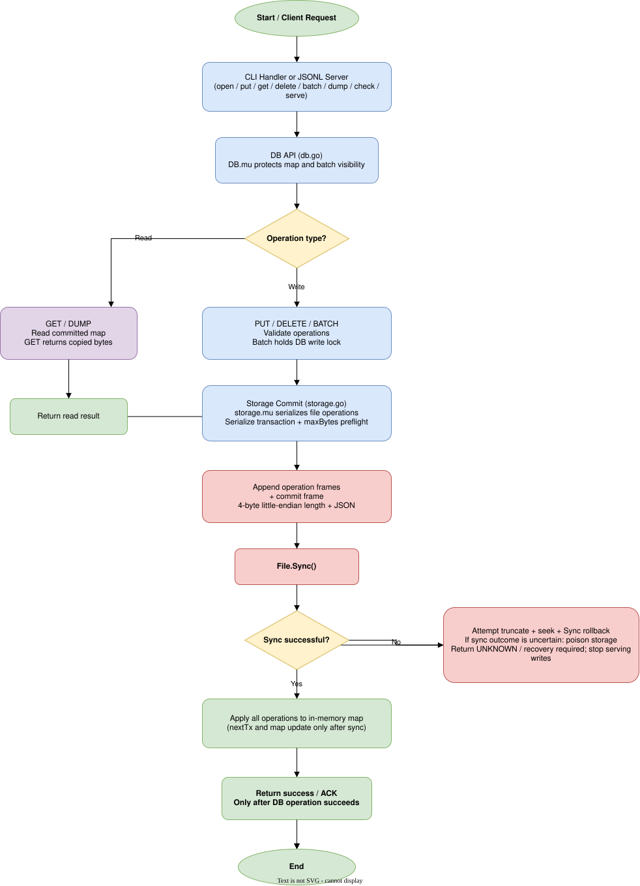

# Kill It and Prove It — Architecture

This document describes the implementation in `src/kvdb` and `src/cmd/kvdb`, not an abstract database design. Evidence labels in the matrix mean: **TESTED** (a named automated test or experiment exists), **CODE-INSPECTED** (the source supports the claim but the exact boundary was not separately exercised), and **UNVERIFIED** (the official scenario has not been demonstrated).

## A. Runtime architecture and ordering



For a write, `DB.Batch` validates all operations, then `storage.commit` serializes the complete group, checks `maxBytes`, writes operation frames, writes one commit frame, and calls `File.Sync`. Only after that returns does `DB.Batch` apply the operations to the in-memory map. The serve loop writes an ACK/success response only after the DB method returns. A failed append attempts truncate, seek, and sync; a sync failure poisons storage even if rollback appears to succeed, so later writes return recovery-required/UNKNOWN rather than pretending the outcome is known.

## B. Actual on-disk format

Legacy records are framed as a 4-byte little-endian `uint32` body length followed by JSON. `diskRecord` has the Go JSON fields `TxID uint64`, `Type OperationType`, `Key []byte`, `Value []byte`, `Commit bool`, and optional `Checksum *uint32`; byte slices use Go JSON base64 encoding. An operation record has `PUT` or `DELETE`, a key, and a transaction ID. A commit record has `Commit:true` and the transaction ID, with no operation payload. `marshalRecord` computes CRC32C (Castagnoli) over the record with `Checksum` omitted, then stores the checksum in JSON. A transaction is visible during recovery only when valid records for one transaction are followed by its valid commit record.

Compaction writes a KVCPv003 frame at offset zero. The implementation uses little-endian integers and a 52-byte header:

| Offset | Size | Field |
|---:|---:|---|
| 0 | 8 | magic `KVCPv003` |
| 8 | 4 | version (3) |
| 12 | 4 | header size (52) |
| 16 | 8 | generation |
| 24 | 8 | checkpoint transaction ID |
| 32 | 8 | entry count |
| 40 | 8 | payload length |
| 48 | 4 | header CRC32C |

The header CRC currently covers header bytes 0–47. The payload is sorted entries, each `uint32` key length, `uint32` value length, key bytes, then value bytes. Payload CRC32C covers payload bytes only. The 8-byte trailer is a frame CRC32C followed by marker `0xC0DEC0DE`; the frame CRC covers header and payload, excluding the frame-CRC field and marker. `loadCheckpoint` validates magic/version/header size, nonzero generation, entry and byte limits, overflow-safe file bounds, both CRCs, exact trailer and marker, sorted unique entries, key/value limits, and complete payload consumption. The implementation’s allocation limits are 10,000,000 entries and 512 MiB total checkpoint size; normal records are limited to 64 MiB, keys to 1,024 bytes, and values to 1 MiB.

There is one authoritative base path. `.compact-tmp` and `.compact-old` are recovery candidates, not independent databases. `openStorage` validates candidates before selecting them, prefers a valid base, otherwise promotes a valid backup, and then a valid temporary candidate where applicable; it removes leftovers after successful recovery. Invalid checkpoint magic at offset zero is an error, not a legacy fallback.

## C. Durability, atomicity, and recovery

`storage.commit` holds the storage mutex while appending a whole transaction. It writes all operation frames, the commit frame, and then calls `File.Sync`. `nextTx` and the DB map change only after successful sync. Thus an acknowledged operation has a durable commit frame before the ACK. A transaction may be committed on disk but unacknowledged if the process dies after sync and before the response; recovery applies it. A physically incomplete final frame or transaction without a commit is ignored/removed under the existing repair rules. A complete malformed record, checksum failure, or transaction-ID regression is rejected rather than silently skipped. Batch visibility is all-or-nothing because the map is updated only after the single commit succeeds.

Recovery detects KVCPv003 at offset zero, loads its snapshot and boundary transaction ID, then `scanFrom` begins exactly after the frame and accepts only strictly newer, valid committed transactions. Legacy files scan from offset zero. `storage.check` performs the same validation without repairing a tail. Recovery truncates only a physically incomplete final frame when `repair` is enabled; truncation, seek, or repair-sync failure poisons storage. Reopening after a successful repair is intended to be repeatable, but exact kill-at-every-recovery-instruction coverage is not claimed.

The three guarantees are bounded: **Durability**—success is returned after the commit frame’s `File.Sync`; **Atomicity**—a batch reaches the map only after its commit marker is durable and recovery applies committed transactions as a group; **Recoverability**—the validator rejects malformed complete data and repairs only permitted physical tails, while uncertain sync outcomes stop further serving. These guarantees address the challenge’s acknowledged-operation model; they do not claim power-loss behavior beyond the platform’s fsync contract.

## D. Compaction and replacement

`DB.Compact` holds the DB write lock, snapshots the committed map and reads the highest committed transaction boundary under the storage mutex. It writes the complete checkpoint to `.compact-tmp`, calls `Sync`, closes it, reopens it, and independently calls `loadCheckpoint`. Only a validated candidate is installed. On Windows, `replace_windows.go` calls `ReplaceFileW` and retains the backup. On other systems, `replace_other.go` renames the base to `.compact-old`, renames the temporary file to the base, and attempts to restore the backup if the second rename fails. The new base is reopened, then backup cleanup is attempted. `syncDir` is best effort and is a no-op on Windows; directory-entry durability after rename is therefore a documented Windows limitation. A process crash can leave a candidate or backup for `openStorage` to validate; handled cleanup errors are different from a process kill.

## E. Concurrency and capacity

The DB `RWMutex` protects the committed map, lifecycle, and batch visibility. GET uses a read lock and returns copied bytes. Batch and compaction use the write lock. `storage.mu` serializes file operations. This is a thread-safety design for one DB instance; the implementation does not provide inter-process locking, and race-detector success is not a history-based linearizability proof.

The torture suite's `linearizability` mode records a bounded real-process
history from concurrent clients and uses `torture/linearizability.py` to search
for a sequential explanation respecting completed-before-invoked ordering.
PUT, GET, DELETE, and atomic BATCH are modeled independently of the database.
The result is `LINEARIZABLE`, `NOT_LINEARIZABLE`, or `INCONCLUSIVE` when the
search budget is exhausted; this is a bounded executable check, not a proof of
all possible histories and not a crash-campaign result.

Before append, `storage.commit` serializes the entire transaction and rejects a configured `maxBytes` overflow without writing it. Physical ENOSPC can still occur during append or sync. Append errors attempt rollback; rollback/sync uncertainty poisons storage and requires recovery. The implementation has injected ENOSPC and rollback tests plus a historical isolated WSL2 ENOSPC experiment, but not every physical-disk failure boundary.

## F. CLI and JSONL protocol

```text
./kvdb open <path> [--max-bytes N]
./kvdb put <path> <key> <value>
./kvdb get <path> <key>
./kvdb del <path> <key>
./kvdb batch <path> <file>     # PUT key value or DELETE key, case-insensitive
./kvdb dump <path>             # sorted current keys
./kvdb check <path>
./kvdb serve <path>
```

Serve prints `READY` on stderr, reads one JSON request per line, and writes only JSON responses to stdout. IDs may be strings or nonnegative integers. Keys and values are base64; an empty value is valid, while missing/null values are invalid. Operations are PUT, GET, DELETE, BATCH, DUMP, and COMPACT. ACK is emitted only after the DB operation returns successfully. A failed/uncertain write is an `ERROR` with `outcome:"UNKNOWN"` when the server must stop; diagnostics never go to stdout.

## G. Performance and evidence

The one-million-key checkpoint benchmark recovered exactly 1,000,000 keys with matching checksum; measured runs were 1,854, 1,955, 1,876, 1,874, and 1,931 ms (mean about 1,898 ms), with a large allocation profile of about 937 MB. The under-two-second target was met by that reported benchmark, but hardware and workload-specific performance remain relevant. `go test -race ./...` passed in the supplied CGO-enabled WSL2 run; this does not prove linearizability. Python regression and targeted crash campaigns were run, including actual child kills/restarts in the reported random campaign, but the official 500-kill campaign and physical disk-exhaustion torture mode remain unverified.

The current implementation also preallocates the recovered checkpoint map from a bounded entry-count hint and preallocates the DB's committed value map from the recovered count. The hint is only an allocation optimization: `loadCheckpoint` remains the authority for header, CRC32C, payload, frame, completion-marker, bounds, ordering, and transaction validation; key and value bytes remain copied into owned memory. A fresh five-run benchmark on 2026-11-07 measured 1,484, 1,162, 1,149, 1,121, and 1,207 ms (mean 1,224.6 ms; median 1,162 ms) for exactly 1,000,000 keys, with checksum `78f35e2f62e790a2c5a3dea427fa07ed5920c8f1a1ef14c0b61ad38716c81795` and CHECK `OK`. It ran under WSL2 on an AMD Ryzen 7 7435HS with 16 logical CPUs, 7.7 GiB visible RAM, Go 1.26.8, and `tmpfs`; cache state was not controlled. This is measured, environment-specific evidence, not a universal performance guarantee.

## H. Official A1–F4 proof matrix

| ID | Official scenario / expected outcome | Expected disk state at crash | Recovery mechanism | Source location | Verification evidence | Status |
|---|---|---|---|---|---|---|
| A1 | Kill before any put bytes reach the file; absent or previous value | Old complete log; no new frame | Legacy scan; no new committed transaction | `storage.commit` | Boundary not separately killed | CODE-INSPECTED |
| A2 | Kill after only part of a record; torn record ignored | Incomplete final length/body | `scanFrom` and `incompleteTail` truncate permitted tail | `storage.go` | Tail-repair tests, not exact kill boundary | CODE-INSPECTED |
| A3 | Kill after record write before fsync; either outcome, no corruption | Complete operation frame, no durable commit guarantee | Commit filtering; committed transaction only if commit is valid | `storage.commit`, `scanFrom` | Sync ordering inspected | CODE-INSPECTED |
| A4 | Kill after fsync returns before put success; key present | Complete committed transaction | Replay valid commit | `storage.commit`, `recover` | No exact immediate process-kill test | CODE-INSPECTED |
| A5 | Kill immediately after put success; key present | Complete synced transaction | Normal recovery | `db.go`, `main.go` | Random child-kill campaign, not exact boundary | CODE-INSPECTED |
| A6 | Kill during delete; old value or absent, never corrupt | Old record or valid delete tail | Commit filtering/tail repair | `DB.Delete`, `storage.commit` | No exact delete-kill boundary | CODE-INSPECTED |
| A7 | Kill during a 1 MiB value put; same A1–A5 rules | Large complete or torn final frame | Size validation and tail repair | `validateRecord`, `scanFrom` | Large-value mode; no exact boundary | CODE-INSPECTED |
| B1 | Kill after 3 of 10 batch operations; none visible | Partial uncommitted transaction | Pending transaction discarded | `DB.Batch`, `scanFrom` | No exact halfway process kill | CODE-INSPECTED |
| B2 | Kill after all operations but before commit marker; none visible | All operation frames, no commit | Pending transaction discarded | `storage.commit`, `scanFrom` | Commit-failure tests; no exact kill | CODE-INSPECTED |
| B3 | Kill after commit marker before fsync; all or none | Commit may be physically present but sync outcome unknown | Valid committed replay or incomplete-tail handling | `storage.commit`, `scanFrom` | Sync injection, not arbitrary kill | CODE-INSPECTED |
| B4 | Kill after batch success; all operations visible | Complete synced batch | Replay commit and operations together | `DB.Batch` | Batch/restart tests | TESTED |
| B5 | Put and delete same key; defined ordering is last operation wins | Valid ordered transaction or no commit | Replay preserves operation order | `DB.Batch`, `apply` | Last-operation-wins tests | TESTED |
| B6 | Kill a 10,000-operation batch halfway; none visible; recovery target | Partial uncommitted large batch | Discard pending batch; repair physical tail | `Batch`, `scanFrom` | Large-batch mode; exact official kill unverified | CODE-INSPECTED |
| C1 | Kill during open replay; next open succeeds with same state | Replay stopped at a valid or incomplete tail | Restart recovery and filtering | `openStorage`, `recover` | Recovery-crash mode at named hooks | TESTED |
| C2 | Kill during torn-tail repair; next open succeeds | Torn tail and possibly incomplete repair | Retry validation/repair on next open | `incompleteTail` | No exact kill during truncate/sync | CODE-INSPECTED |
| C3 | Kill compaction before replacement; old data intact | Old base plus absent/partial temp | Validate base; discard invalid temp | `compactLocked`, `openStorage` | Compaction crash mode | TESTED |
| C4 | Kill during rename/swap; one complete authoritative state | Old/base, backup, or new candidate | Validate candidates and select a complete base | `replace_*`, `openStorage` | Replacement hook tested; all OS boundaries not tested | CODE-INSPECTED |
| C5 | Kill after swap before cleanup; data intact | New base plus backup/temp | Validate new base; clean leftovers | `openStorage`, `compactLocked` | Compaction crash mode | TESTED |
| C6 | Kill during close; same as any kill | Previously synced records; close may be interrupted | Normal open/recovery | `DB.Close`, `storage.close` | No exact close-kill test | CODE-INSPECTED |
| D1 | Two writers, different keys, random kill; ACKed puts survive | Interleaved but serialized transactions | Storage mutex and committed replay | `DB.Batch`, `storage.mu` | Concurrent writer tests; no history checker | CODE-INSPECTED |
| D2 | Two writers, same key; one actual value, never mixed | Whole value records, serialized commits | Last committed value wins | `DB.Batch`, `Get` | Concurrent tests; no kill-history proof | CODE-INSPECTED |
| D3 | Long batch plus single puts; batch all-or-nothing | Serialized complete or incomplete transactions | Commit filtering and DB lock | `DB.Batch`, `storage.commit` | Concurrent tests; exact kill interleaving unverified | CODE-INSPECTED |
| D4 | Reader during batch sees before or after, never intermediate | Map unchanged until batch commit | DB RWMutex and atomic map apply | `DB.Get`, `DB.Batch` | Concurrent read/write tests | CODE-INSPECTED |
| E1 | Size cap during single put; error and old data intact | No append after preflight, or rolled-back append | maxBytes preflight/rollback | `storage.commit` | Size-limit tests | TESTED |
| E2 | Size cap halfway batch; error and none visible | Preflight rejection or rollback | No map apply without commit | `storage.commit`, `DB.Batch` | Batch atomicity and ENOSPC injection | TESTED |
| E3 | Cap then kill; restart succeeds and ACKed data intact | Rolled-back/poisoned or prior valid log | Recovery-required behavior and recovery | `rollbackAfterFailure`, `openStorage` | Injected ENOSPC campaign; all physical cases unverified | TESTED |
| E4 | Cap during compaction; no loss and DB opens | Old base or validated new base | Candidate validation and selection | `compactLocked`, `openStorage` | Compact size-limit test | TESTED |
| E5 | Deletes free space, compaction, then writes work | Valid compacted base | Reopen new base and continue append | `Compact`, `storage.commit` | Delete/compact/write tests | TESTED |
| F1 | 500 random kill/restart cycles preserve invariant | Varies by crash boundary | Recovery each cycle | `torture/campaign.py`, `openStorage` | Only 30-kill campaign reported | UNVERIFIED |
| F2 | Kill during recovery repeatedly; recovery idempotent | Partially replayed/repairing file | Restart validation and replay | recovery hooks, `openStorage` | Named recovery hooks tested; repeated official sequence unverified | UNVERIFIED |
| F3 | 1M keys, kill, open under 2s, all ACKed keys present | Large valid log/checkpoint plus possible tail | Checkpoint load and post-checkpoint replay | `loadCheckpoint`, `scanFrom` | 1M recovery benchmark; exact kill scenario unverified | CODE-INSPECTED |
| F4 | Remove one byte from end by hand; open succeeds, at most last unacknowledged record lost | One-byte physical truncation | Incomplete-tail repair | `incompleteTail` | Tail truncation tests; exact manual procedure not separately reported | CODE-INSPECTED |

The matrix preserves the official scenario IDs and expected outcomes. It intentionally does not upgrade source inspection or injected faults into proof of an arbitrary `kill -9` instruction boundary, and it does not claim that race detection establishes a linearizability history.

## I. Source map

Core API and locking: `src/kvdb/db.go` (`Open`, `Get`, `Put`, `Delete`, `Batch`, `Compact`, `Check`, `Close`). Storage and recovery: `src/kvdb/storage.go` (`openStorage`, `recover`, `scanFrom`, `loadCheckpoint`, `storage.commit`, `incompleteTail`, `compactLocked`, `check`). Platform replacement: `src/kvdb/replace_windows.go` and `src/kvdb/replace_other.go`. CLI and protocol: `src/cmd/kvdb/main.go`. Tests are in `src/kvdb/*_test.go`, `src/cmd/kvdb/*_test.go`, `tests/`, and `torture/`.
